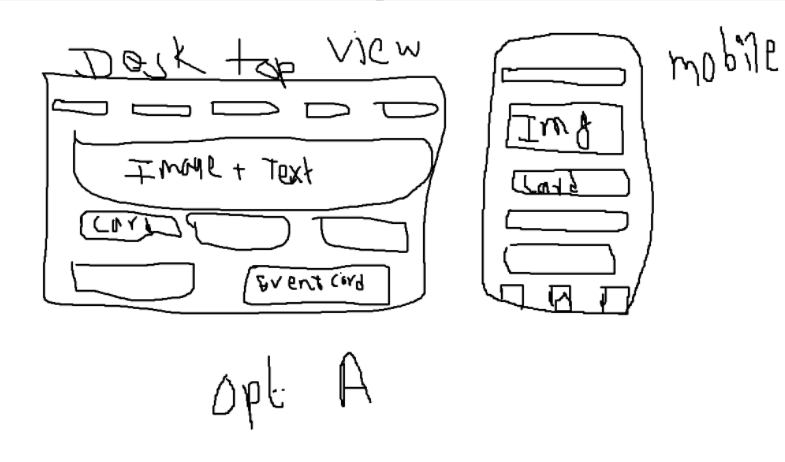
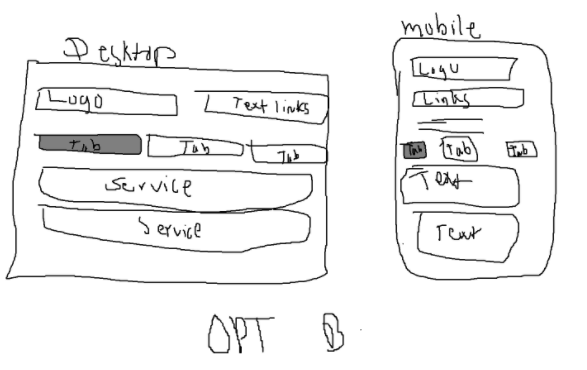
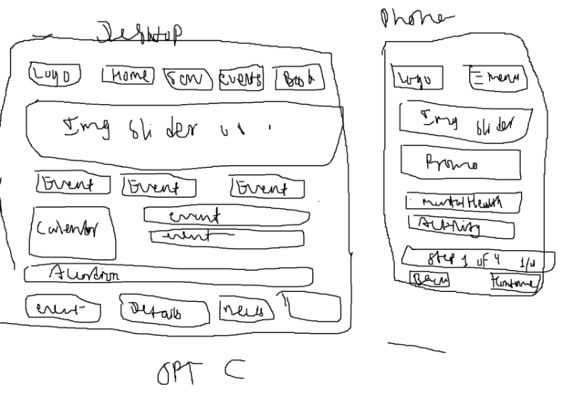

# Week 2: Ideate (Three Design Options)

## What I did
- Sketched three different UI options as low-fidelity wireframes (desktop and mobile)
- Listed the strengths and weaknesses of each, using the Week 1 personas
- Scored the options against criteria from the brief, WCAG 2.2 and Nielsen's heuristics

## Option A: Visual card grid

## Option B: Text-first with tabs

## Option C: Guided hybrid (chosen)

**Result:** Option C is best . It works best for Margaret and Daniel (step-by-step, less overwhelming), Priya (mobile and calendar) and Samuel (ARIA patterns).

## Reflection
Option B was the most accessible but felt cold, and Option A looked good but showed too much at once. Combining patterns in Option C balanced both, but it is harder to build, so I will need to test it carefully.

**Next:** build the first version of Option C.

