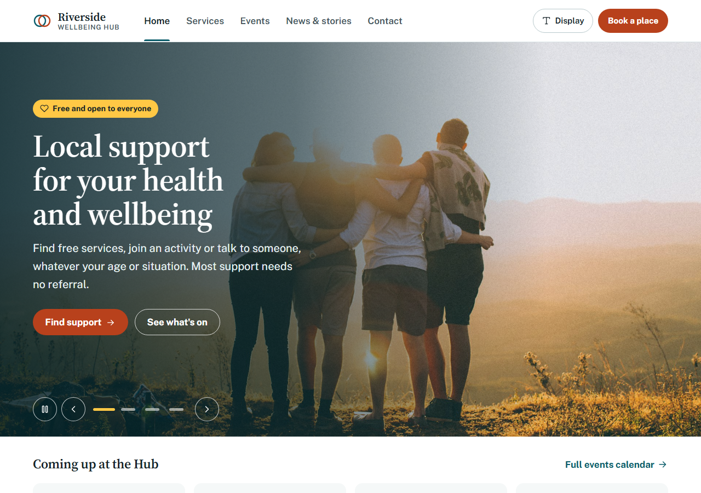
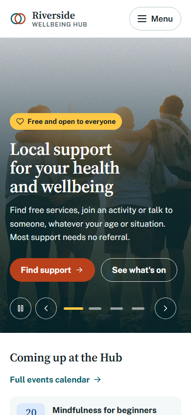
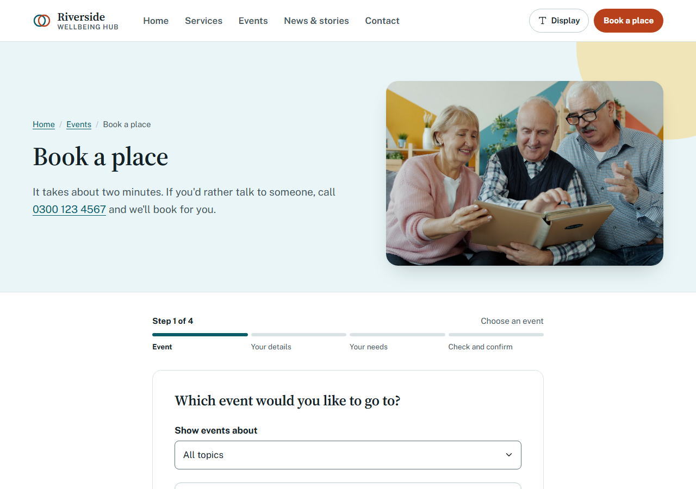
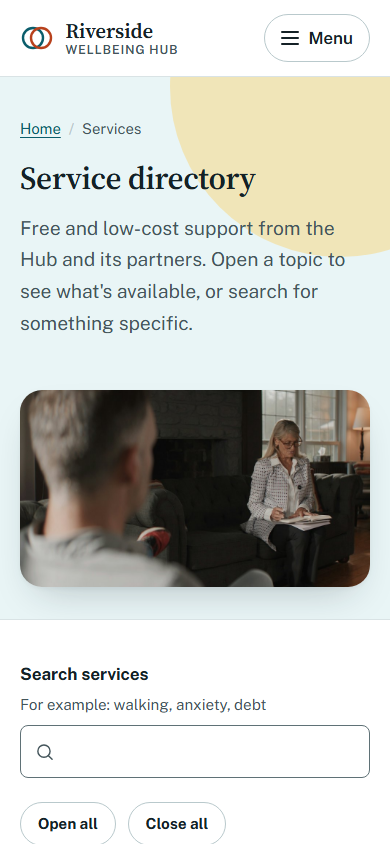
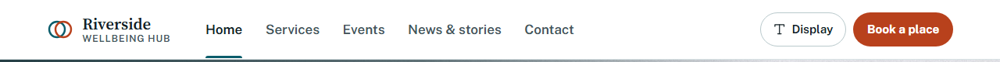

# Week 5: Final Version (Version 3), Testing and Reflection

## What I did
- Added real photography, a brighter palette, an accessible image slider and a stories carousel (Version 3)
- Ran an automated accessibility audit (axe-core 4.10, WCAG 2.2 AA) on every page at desktop and phone sizes
- Tested every page at phone, tablet and desktop widths, and tested all key tasks with the keyboard only
- Fixed every issue found and planned usability testing with real users

## Final prototype

| Desktop | Phone |
|---|---|
|  |  |
|  |  |

## Testing observations

| Found by | Problem | Fix |
|---|---|---|
| Heuristic review | Slider moved on its own with no way to stop it | Added pause; stops on hover, focus and "reduce motion" |
| Accessibility audit | Button text had a 1:1 contrast ratio | Fixed CSS so text is white on dark |
| Accessibility audit | Coral labels just under the 4.5:1 minimum | Darkened to #b8411c (5.1:1) |
| Accessibility audit | Scrolling table not reachable by keyboard | Made focusable and labelled |
| Functional test | "Back" button showed on booking step 1 | Fixed a CSS rule |
| Responsive test | Photos stretched on phones | Images keep their shape at every size |
| Responsive test | Jump links landed under the sticky header | Added a scroll offset |

**Result:** 0 accessibility violations on every page at desktop and phone sizes.

## Cognitive walkthrough: booking a place (27 November 2026)
Carried out as **Margaret, 72, not confident online**. Q1 = knows what to do, Q2 = notices the control, Q3 = links it to her goal, Q4 = sees progress.

| Step | Q1 | Q2 | Q3 | Q4 | Problem found / notes |
|---|---|---|---|---|---|
| 1. Click "Book a place" in the header | Y | Y | Y | Y | The button is easy to spot and Margaret understands where it will take her. |
| 2. Choose a topic and an event | Y | Y | Y | Y | The choices are clear enough. She can understand what she needs to select. |
| 3. Choose the number of places | Y | Y | Y | N | She hesitates and wonders whether choosing 2 places means two people in total. The change on screen isn't very obvious. |
| 4. Click "Continue" | Y | Y | Y | N | If she hasn't selected an event, the error message could be easier to notice. She might think the button isn't working. |
| 5. Enter name, email and contact preference | Y | Y | Y | Y | The fields are familiar, and she understands what information she needs to enter. |
| 6. Choose access needs or language (optional) | N | Y | N | Y | She's unsure whether she has to select something here. The optional part could be explained more clearly. |
| 7. Check the summary and use a "Change" link | Y | N | Y | Y | She understands the summary but almost misses the small Change link. |
| 8. Tick the agreement box and confirm | Y | Y | Y | N | She understands what to do but would like a clearer indication that her booking is being submitted. |
| 9. Read confirmation and booking reference | Y | Y | Y | Y | The confirmation makes it clear that the booking was successful. She would probably write down the reference number. |

**Main findings**
1. Margaret struggled most with understanding the number of places in step 3.
2. Step 6 caused confusion because she wasn't sure whether the access and language options were compulsory.
3. The Change link in step 7 was a little too small and easy to miss.
4. The confirmation after submitting the booking could be more noticeable.

Steps 3 and 6 match what P1 and P3 struggled with in user testing.

## Change made after user testing (27 November 2026)
P1 (older adult) could not find the "Display" button when asked to make the text bigger, and suggested making the text-size option easier to notice. I renamed the button **"Text size"** and the panel heading to "Text size and contrast".

**Before**

**After**

## Usability testing plan (next step)
Five participants matching the personas (older adult, parent, younger adult, low-confidence user, screen-reader user) will try five tasks while thinking aloud, e.g. *book 2 places on a health walk* and *make the text bigger*. I'll measure completion, time, errors and a SUS score.

## Final reflection
Over five weeks the design moved from cluttered (v1) to plain (v2) to warm and accessible (v3). Each round of feedback and testing changed the design. The biggest lesson was balancing looks against accessibility: every visual addition brought new risks that testing caught. The main limitation is that the site hasn't been tested with real users yet. That is the next step.
